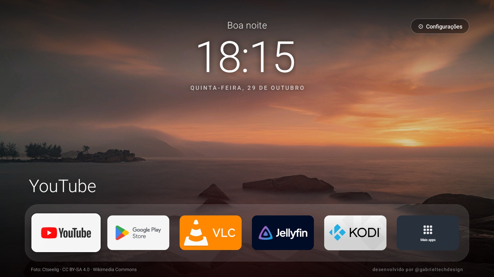
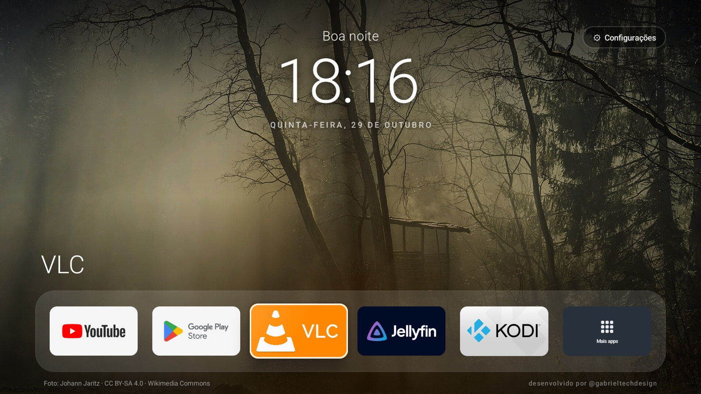
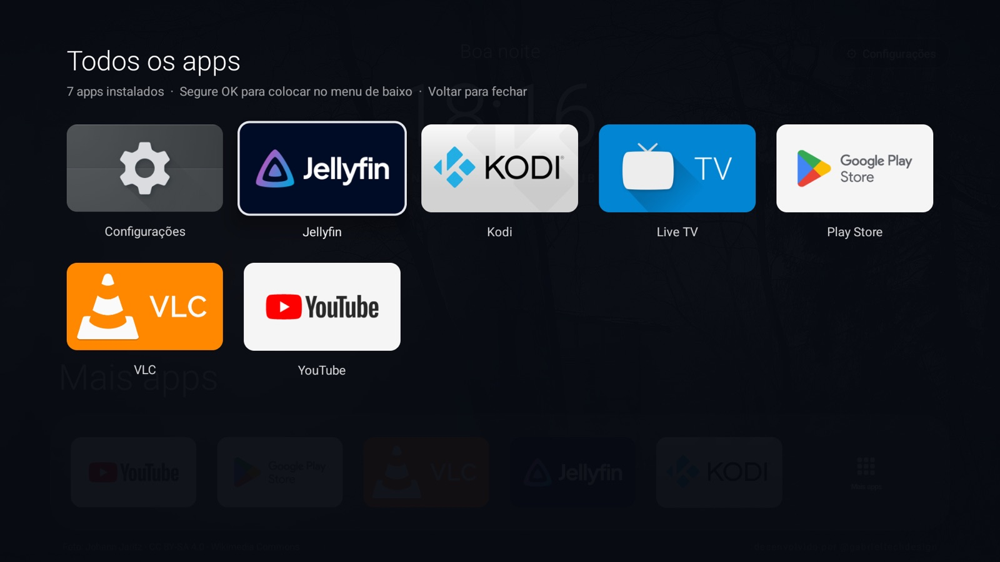
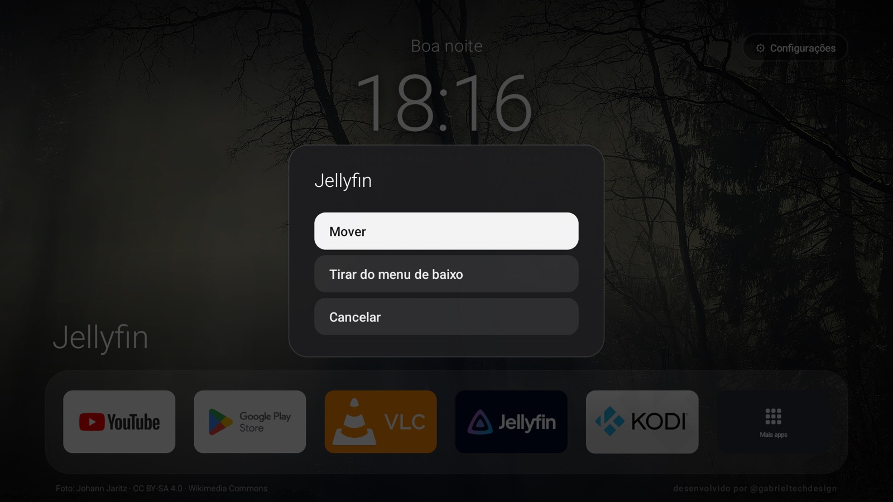
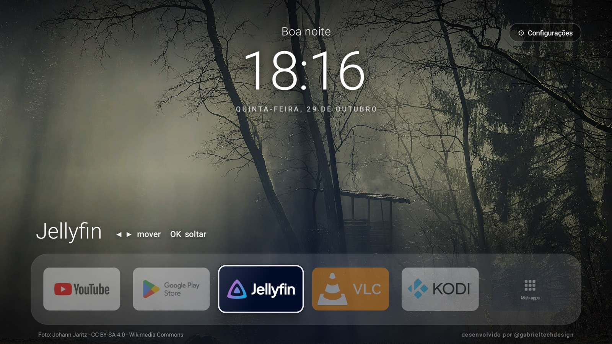

# Android TV V2

Tela inicial limpa, no estilo Apple TV, para Android TV e Google TV. Sem propaganda, com paisagens que mudam
sozinhas e um menu de baixo que **se monta com os apps que você usa**. **Sem root e sem formatar:** tudo pela rede,
via ADB, e tudo reversível.



## Como fica

| | |
|---|---|
|  |  |
| **Tela inicial.** Relógio, paisagem sorteada e o menu de baixo com os apps que você mais abre. | **Mais apps.** Todos os apps instalados. Segure OK num app para colocar no menu de baixo. |
|  |  |
| **Segure OK num app** para mover ou tirar do menu de baixo. | **Mover:** setas ◀ ▶ trocam o app de lugar e OK solta. |

> Prints do emulador oficial de Google TV (Android 14), com VLC, Kodi e Jellyfin instalados para exemplo.
> Na sua TV aparecem os seus apps.

## Funciona na minha TV?

| Aparelho | Android | Funciona? |
|---|---|---|
| TVs e sticks com **Google TV** (Chromecast com Google TV, TCL, Philips, Sony recentes...) | 10 a 14 | **Sim**, como tela inicial |
| TVs e sticks com **Android TV** (Xiaomi Mi TV Stick/Box, TVs de 2016 em diante...) | 5.0 a 12 | **Sim**, como tela inicial |
| **Fire TV** com Fire OS 5 a 8 (Fire TV Stick até o 4K Max 2ª geração, TVs Fire TV) | 5.1 a 11 | **Só como app**: a Amazon não deixa trocar a tela inicial |
| **Fire TV** com Vega OS (Fire TV Stick 4K Select e HD de 2025 em diante) | não é Android | **Não**: a Amazon bloqueia instalar apps de fora da loja |
| Aparelhos com Android anterior ao 5.0 | 4.x | **Não** |

O instalador reconhece sozinho se a TV é Google TV, Android TV ou Fire TV e faz o que dá em cada uma.
Feito num **Xiaomi Mi TV Stick** (Android TV 9) e testado no emulador oficial de **Google TV** (Android 14).

## O que você precisa

A instalação é feita **de um computador**, pela rede Wi-Fi. Na TV não se instala nada pela loja.

| Onde | O quê | Precisa instalar? |
|---|---|---|
| TV | Android TV, Google TV ou Fire TV, no **mesmo Wi-Fi** do computador | **Nada.** Só ligar a depuração (passo 1) |
| Computador | **macOS ou Linux** | Windows: pelo [WSL](https://learn.microsoft.com/windows/wsl/install) (não testado) |
| Computador | **Git** | **Sim.** macOS: `xcode-select --install` · Linux: `sudo apt install git` |
| Computador | **Java (JDK) 17 ou mais novo** | **Sim.** Baixe o [Temurin](https://adoptium.net/) · Linux: `sudo apt install openjdk-17-jdk` |
| Computador | adb e ferramentas do Android (build-tools, plataforma) | **Não.** O `setup-sdk.sh` baixa sozinho (~400 MB) para dentro da pasta do projeto |
| Computador | Android Studio | **Não precisa** |

Para conferir o que já tem, rode `git --version` e `java -version` no Terminal. Se os dois responderem (e o Java
for 17 ou mais), está pronto.

## Instalação rápida

Já com a depuração ligada na TV (passo 1 abaixo), são estes comandos no Terminal do computador. Troque o IP pelo
da sua TV:

```bash
git clone https://github.com/ogabrielmoreira/Android-TV-V2.git
cd Android-TV-V2
scripts/setup-sdk.sh
export TV=192.168.1.44:5555
scripts/connect.sh
launcher/build.sh
scripts/install-launcher.sh
```

| Comando | O que faz |
|---|---|
| `git clone ...` e `cd ...` | Baixa o projeto e entra na pasta |
| `scripts/setup-sdk.sh` | Baixa o adb e as ferramentas do Android para `.sdk/` (só na primeira vez) |
| `export TV=...` | Diz qual é a TV: o IP dela e a porta 5555 |
| `scripts/connect.sh` | Conecta na TV. Na TV, aceite **"Permitir depuração USB?"** com **Sempre permitir** |
| `launcher/build.sh` | Gera o app da tela inicial (`launcher/build/tvhome.apk`) |
| `scripts/install-launcher.sh` | Instala na TV e deixa como tela inicial |

Pronto: aperte Home no controle.

## Passo a passo

### 1. Prepare a TV

Ligue as opções do desenvolvedor e a depuração. Os menus mudam um pouco conforme o aparelho:

| Aparelho | Liberar as opções do desenvolvedor | Ligar a depuração |
|---|---|---|
| Android TV | **Configurações → Preferências do dispositivo → Sobre** → OK em **Build** 7 vezes | **Preferências do dispositivo → Opções do desenvolvedor → Depuração USB** |
| Google TV | **Configurações → Sistema → Sobre** → OK em **Build do SO do Android TV** 7 vezes | **Sistema → Opções do desenvolvedor → Depuração USB** |
| Fire TV | **Configurações → Minha Fire TV → Sobre** → OK no nome do aparelho 7 vezes | **Minha Fire TV → Opções do desenvolvedor → Depuração ADB** |

Com a depuração USB ligada, o aparelho aceita ADB pela rede na porta 5555. Se a sua TV mostrar
**Depuração sem fio** com um código de pareamento, use `adb pair` com o endereço e o código que ela mostra, e depois
o endereço de conexão no lugar do `:5555`.

Anote o IP da TV (**Configurações → Rede e internet →** sua rede).

### 2. Prepare o computador

Instale o Git e o Java (tabela [O que você precisa](#o-que-você-precisa)). Depois baixe o projeto e as ferramentas:

```bash
git clone https://github.com/ogabrielmoreira/Android-TV-V2.git
```

```bash
cd Android-TV-V2
```

```bash
scripts/setup-sdk.sh
```

O `setup-sdk.sh` baixa do Google o adb, o build-tools 36.1 e a plataforma Android 9 para a pasta `.sdk/`.
Nada é instalado no sistema: apagar a pasta do projeto apaga tudo.

### 3. Conecte na TV

```bash
export TV=192.168.1.44:5555
```

```bash
scripts/connect.sh
```

Na TV aparece **"Permitir depuração USB?"**: marque **Sempre permitir** e confirme. O script mostra o modelo, a
versão do Android e a memória da TV.

> **macOS:** se aparecer `No route to host` com a TV respondendo ao `ping`, é o macOS bloqueando o `adb`
> na rede local. Rode os comandos pelo app **Terminal** (e permita "Rede local" se ele pedir).

### 4. Limpeza (opcional)

Remove apps de fábrica que pesam e não são usados, **só para o usuário**: nada é apagado do sistema e tudo volta
com um comando. A lista do Xiaomi Mi TV Stick está em
[`devices/xiaomi-mi-tv-stick/debloat.txt`](devices/xiaomi-mi-tv-stick/debloat.txt). Confira antes e tire dela o
que você usa.

```bash
scripts/debloat.sh devices/xiaomi-mi-tv-stick/debloat.txt
```

A lista de pacotes de antes fica salva em `backup/`.

### 5. Compile e instale

```bash
launcher/build.sh
```

```bash
scripts/install-launcher.sh
```

O instalador confere o Android da TV, instala o app, desativa (não apaga) a tela inicial de fábrica, liga o serviço
**"Botões do controle"** (só o botão Apps), libera o **acesso a uso** e aperta Home. No Fire TV ele só instala e
abre a V2 como app, porque a Amazon não deixa trocar a tela inicial.

O acesso a uso deixa o menu de baixo ver os apps abertos por qualquer caminho, inclusive pelos botões do controle.
Sem ele, o menu aprende só com os apps abertos pela própria tela inicial.

### 6. Suas fotos (opcional)

Envie uma pasta com suas fotos. Elas substituem as paisagens do Wikimedia Commons e as 12 que vêm no app:

```bash
scripts/push-wallpapers.sh ~/Pictures/wallpapers-tv
```

Fotos grandes de celular são reduzidas automaticamente. Use imagens na horizontal.

## Como funciona

- **Paisagens que mudam sozinhas:** a cada 10 minutos entra uma paisagem sorteada entre as centenas de
  [fotos destacadas de paisagens do Wikimedia Commons](https://commons.wikimedia.org/wiki/Category:Featured_pictures_of_landscapes),
  todas com licença livre e com o nome do autor no rodapé. Sem internet, sorteia entre as 12 que vêm no app.
- **Menu de baixo que aprende:** na primeira vez ele mostra os apps de streaming mais comuns que estiverem
  instalados (YouTube, Netflix, Prime Video, Globoplay, Disney+, Play Store). Daí em diante, cada app que você
  abre entra no fim do menu. Com o menu cheio (6 apps), sai o que você usa há mais tempo.
- **Organizar pelo controle:** segure **OK** (ou aperte o botão **Menu**) num app:
  - no menu de baixo: **Mover** (setas ◀ ▶ trocam de lugar, OK solta) ou **Tirar do menu de baixo**;
  - na grade ou em "Mais apps": **Colocar no menu de baixo**.

  Um app tirado à mão não volta sozinho quando você abre ele de novo; só se você colocar de volta.
- **Todos os apps:** o card "Mais apps", no fim do menu de baixo, abre todos os apps instalados. O botão
  **Apps (⋮⋮⋮)** do controle também abre esse menu.
- **Botões do controle intactos:** Netflix abre o Netflix, Prime Video abre o Prime Video, e assim por diante.
- **Volta ao original quando quiser:** um comando troca entre esta tela e a de fábrica.

### O que muda em relação à versão 1

| | Versão 1 | V2 (esta) |
|---|---|---|
| Menu de baixo | Lista fixa de apps no código | Aprende sozinho com os apps que você abre |
| Organizar o menu de baixo | Editando o código | Pelo controle: segure OK num app para mover ou tirar |
| Botões Netflix e Prime do controle | Desviados para outros apps | **Continuam como vieram de fábrica** |
| Papel de parede | 12 fotos em sequência | Paisagens sorteadas do Wikimedia Commons |
| Marca | Logo do autor na tela | Só uma assinatura discreta no rodapé |
| Aparelhos | Android TV 9 ou mais novo | Android 5.0 ou mais novo, Google TV e Fire TV |

## Personalize

Tudo em [`launcher/res/values/config.xml`](launcher/res/values/config.xml). Depois rode `launcher/build.sh` e
`scripts/install-launcher.sh` de novo:

- `dock_max`: quantos apps cabem no menu de baixo.
- `dock_suggestions`: os apps que aparecem na primeira vez.
- `dock_ignore`: apps que nunca entram sozinhos no menu de baixo (ex.: Configurações).
- `hidden_apps`: apps que nunca aparecem.
- `online_wallpapers`: `false` para usar só as fotos do app, sem internet.

A assinatura do rodapé fica em [`launcher/res/values/strings.xml`](launcher/res/values/strings.xml) (`signature`).

Nomes de pacote: `adb shell pm list packages`.

## Como voltar ao original

| Quero | Comando |
|---|---|
| Voltar para a tela de fábrica (Android TV / Google TV) | `scripts/switch-interface.sh android-tv` |
| Voltar para esta tela | `scripts/switch-interface.sh nova` |
| Reinstalar os apps removidos na limpeza | `scripts/restore.sh devices/xiaomi-mi-tv-stick/debloat.txt` |
| Tirar um print da TV | `scripts/screenshot.sh` |

Um reset de fábrica também desfaz tudo.

## Problemas conhecidos

- **`No route to host` no macOS:** o macOS bloqueia o `adb` na rede local. Rodar pelo app Terminal resolve.
- **`java: command not found` ou erro no `build.sh`:** falta o Java 17 ou mais novo (tabela
  [O que você precisa](#o-que-você-precisa)).
- **O botão Home sempre volta para a tela de fábrica:** ela é app de sistema com prioridade maior. O
  `install-launcher.sh` a desativa (não apaga). Se você reativou, rode `scripts/switch-interface.sh nova`.
- **Android 5 e 6 perguntam "Abrir com" ao apertar Home:** escolha **Início** e **Sempre**. Esses Androids não
  têm o comando que define a tela inicial sozinho.
- **Fire TV volta para a tela da Amazon ao apertar Home:** é bloqueio da Amazon. A V2 fica como app na lista de apps.
- **Reinstalar o launcher desliga o serviço "Botões do controle":** o `install-launcher.sh` religa.
  Manualmente: Configurações → Acessibilidade → Botões do controle.
- **O d8 do build-tools 34 quebra com o JDK 21** (`NullPointerException` em classes anônimas):
  use o build-tools 36.1, que é o que o `setup-sdk.sh` baixa.

## Segurança

- Quando terminar, **desligue a Depuração USB**: com ela ligada, a porta 5555 fica aberta na sua rede.
- O serviço "Botões do controle" só recebe as teclas do controle. Ele não lê o conteúdo da tela.
- O acesso a uso é lido só para saber o nome dos apps abertos, e essa informação não sai da TV.
- O launcher só acessa a internet para baixar as paisagens do Wikimedia Commons. Para desligar, mude
  `online_wallpapers` para `false` em `config.xml`.

## Estrutura

```text
launcher/                      tela inicial (Java puro, sem Gradle) e o serviço do botão Apps
  res/values/config.xml        tamanho do menu de baixo, sugestões, apps escondidos, papel de parede
  res/values/strings.xml       assinatura do rodapé e textos do serviço
  assets/wallpapers/           12 fotos para quando não há internet (créditos em assets/credits.txt)
scripts/                       setup do SDK, conexão, limpeza/restauração, instalação, papéis de parede
devices/xiaomi-mi-tv-stick/    lista de limpeza e mapa dos botões do controle
docs/                          prints da interface
upstream-tv-home/              projeto original tv-home (ferramentas em Python, exemplos, prompt)
```

## Créditos e licença

- Launcher base: [tv-home](https://github.com/mihirgupta0900/tv-home), de Mihir Gupta, licença MIT.
- Paisagens: [Wikimedia Commons](https://commons.wikimedia.org/), cada foto com sua licença livre. O autor aparece
  no rodapé da tela; as 12 do app estão em [`launcher/WALLPAPER-CREDITS.md`](launcher/WALLPAPER-CREDITS.md).
- Adaptação, scripts e V2: Gabriel Moreira (@gabrieltechdesign).

Código sob licença MIT, ver [LICENSE](LICENSE).
